  

<b>I help companies worldwide, US technology companies first, get found on Google and in AI answers, then build the AI automations that keep that growth running, with a person approving every step that goes live.</b>

  
  
  
  

  

## Results

  
  
  

| Result | Before | Now | Source and date |
|---|---:|---:|---|
| Google impressions, 28 days (AI sales platform) | 12,146 | **71,241** | Search Console, 28 days to 20 Oct vs 26 Oct to 22 Nov 2026 |
| Queries in Google's top 10 (AI sales platform) | 87 | **712** | Search Console, same windows |
| Position of a competitor comparison page | 18.9 | **7.8** | Search Console, same windows |
| Visits from ChatGPT, 28 days (AI sales platform) | 20 | **41** | GA4 referral sessions, same windows |
| Median mobile LCP, 267 pages (software company) | 14.0 s | **2.8 s** | Lighthouse 13.5.0, 25 Sep vs 2 Oct 2026 |
| Desktop pages at 2.5 s or less (268 measured) | 3 | **266** | Lighthouse 13.5.0, 25 Sep vs 2 Oct 2026 |
| Image alt-text coverage, 5,310 images | 84.2% | **99.1%** | Full site crawl, 18 Sep 2026 |
| Google clicks, 28 days (software company) | 96 | **160** | Search Console, 28 days to 23 Sep vs to 22 Nov 2026 |

Company names are withheld at their request. Every figure is quoted as read on the date shown. The portfolio has the full charts and an honest read on each number, including what did not improve.

## What I do

- **SEO that compounds:** technical, on-page and local SEO, JSON-LD schema, sitemaps, IndexNow and internal linking.
- **AEO and GEO (AI search visibility):** answer-first pages and llms.txt, so ChatGPT, Perplexity, Gemini and Copilot can find and cite a site, checked with 20 fixed buyer questions per company.
- **Page speed:** Core Web Vitals, critical CSS, lighter images and stable layouts.
- **AI agents with a person in control:** agents that do the work while a person presses Approve, Request change or Deny.
- **Automation and reporting:** 50+ scheduled AI routines in Python and Node.js, and reports where every number carries its source and date.

## Case studies

<b>AI sales platform (US): from a young site to page one for buyer comparisons</b>

 

**Starting point:** a young site with little search history, competing with established sales-engagement tools. 26 Google clicks and 3,360 impressions in the 28 days before tracking began.

**What I did**
- Built a 90-day organic growth plan and ran it as a 45-day sprint, with day-by-day tasks and targets set before the work started.
- Shipped answer-first buyer pages: competitor alternatives and head-to-head comparison pages with FAQ content.
- Technical SEO: JSON-LD schema, llms.txt, a sitemap index, IndexNow, 301 consolidation and internal linking.
- Weekly Search Console, GA4 and AI-answer tracking.

**What changed in one month**

| Measure | 28 days to 20 Oct | 28 days to 22 Nov |
|---|---:|---:|
| Google impressions | 12,146 | **71,241** |
| Queries in the top 10 | 87 | **712** |
| Queries in the top 3 | 15 | **57** |
| Average Google position | about 20.4 | **13.2** |
| Competitor comparison page position | 18.9 | **7.8** |
| Pages cited in AI answers (Semrush, 16 Oct vs 13 Nov) | 8 | **33** |

**Honest read:** about 433 of the 712 top-10 queries are US area-code lookups. They add reach but few clicks, so clicks per impression fell from 0.25% to 0.12%. The next step is turning the buyer pages already on page one into clicks.

Source: Google Search Console and Semrush, read 16 Oct to 23 Nov 2026.

<b>Software company (US): a 273-page site from 14 seconds to under 3 on a phone</b>

 

**Starting point:** on the company's WordPress site, the main content took a median 14.0 s to appear on a phone, and every page downloaded about 60 stylesheets before it could show anything.

**What I did**
- Generated critical CSS for the first screen of every page (534 files, one for phones and one for desktop), each checked against the full page render.
- Held the remaining stylesheets until the first screen loaded, and made the main image load first.
- Moved heavy images to WebP: 102 blog featured images went from 167 MB to 32 MB in total, and a 4.1 MB hero became a 50 KB file on phones.
- Stopped layout jumps with size-matched fallback fonts, and wrote alt text for 237 media items, checked by re-crawling all 274 indexable pages.

**Before and after**

| Measure | Before | After |
|---|---:|---:|
| Median mobile LCP, 267 pages | 14.0 s | **2.8 s** |
| Median desktop LCP, 268 pages | 4.5 s | **1.7 s** |
| Desktop pages at 2.5 s or less | 3 | **266** |
| Median performance score, mobile / desktop | 56 / 59 | **76 / 87** |
| Image alt-text coverage | 84.2% | **99.1%** |

Source: Lighthouse 13.5.0 on every sitemap page, 25 Sep vs 2 Oct 2026; full site crawl, 18 Sep 2026.

<b>An AI social media agent with a person in control</b>

 

An AI agent that works through a **188-item social media checklist** for each client: research and competitor analysis, the content calendar, post creation, scheduling, posting and comment replies. A person only presses Approve, Request change or Deny.

- **7 platform connections:** Meta, X, YouTube, LinkedIn, Threads, Pinterest and Google Business Profile.
- Video studio, post metrics, a comment inbox with AI reply drafts, and GA4 attribution for each post.
- **81 pull requests** delivered.

Source: project record, Jun to Nov 2026.

<b>SEO automation and growth operations that run on a schedule</b>

 

- An SEO automation module: **117 checklist items** worked through by **14 AI runners**, behind the same human-approval step. Every change is re-measured at 14 and 28 days.
- **50+ scheduled AI routines:** weekly keyword and AI-answer tracking, indexing requests, blog publishing, social posting checks and reports.
- Python and Node.js tools built with Claude Code for AI citation tracking, sitewide Lighthouse audits, crawling and brand-mention monitoring.
- Integrations with **7 platform APIs:** Search Console, GA4, Bing Webmaster Tools, Semrush, Notion, Google Drive and WordPress.

Source: project record, Jun to Nov 2026.

## Tech and tools

  <b>Build and automate</b> 
  
  
  
  
  

  <b>Measure</b> 
  
  
  
  

  <b>Publish and design</b> 
  
  
  

Also: Ahrefs, Canva, Screaming Frog, Bing Webmaster Tools, Microsoft Clarity, PageSpeed Insights, JSON-LD schema, llms.txt and IndexNow.

## How I work

| 1. Plan | 2. Ship | 3. Measure | 4. Report |
|---|---|---|---|
| A dated plan with targets agreed before work starts, broken into daily tasks. | Fixes backed by the platform's own documentation, with a rollback for anything hard to undo. A person approves what goes live. | Owned data first: Search Console, GA4 and Bing Webmaster Tools, plus Semrush for authority and AI visibility. | Weekly reads and 30, 45 and 60 day checkpoints that say what worked, what did not and what to cut. |

## Free 10-minute website review

Send me your website address and I will look at it for search, AI answers and page speed. <b>Email me or message me on LinkedIn.</b>

  
  

Based in Pakistan, working remotely with companies worldwide (US hours welcome). Last updated 26 Nov 2026.

